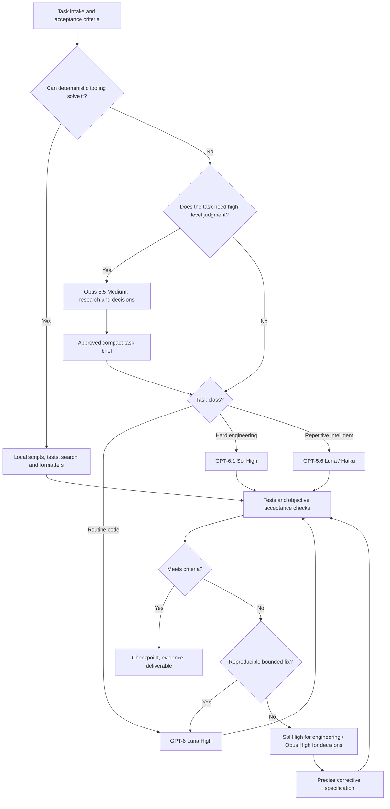

# TOKENMAXXING

**The Premium Model Delegation & Token-Efficiency System** — quality-first, token-efficient multi-model AI execution.

### A research-backed architecture for multi-model intelligence, software execution, agent handoffs, and token-efficient delivery

**Public research paper + implementation reference**  
**Created by [Shivam Kumawat](https://github.com/ohnoshivm) (@ohnoshivm) · AgentKind Labs**    
**Version:** 1.2  
**Research date:** 21 October 2026  
**Evidence priority:** [Artificial Analysis](https://artificialanalysis.ai/) → provider documentation → T3 documentation → project-specific controlled experiments  
**Status:** Proposed operating policy and portable implementation kit; **not** a claim that the author's applications have already been configured.  
**Platform:** Designed for a unified T3-based workflow, with portable instructions usable elsewhere.

> **Thesis:** The most useful multi-model system does not maximize the number of models, agents, or thinking tokens. It maximizes *verified outcome quality per unit of scarce resource*: subscription allowance, API spend, token consumption, execution time, and human review attention.

---

## Install and use TOKENMAXXING — now an actual toolkit

**One-command bootstrap (macOS/Linux, Python 3.9+ and Git):**

```bash
git clone https://github.com/ohnoshivm/tokenmaxxing.git
cd tokenmaxxing
./install.sh
```

The installer stages **eight pinned upstream optimizer repositories** and installs the self-contained `TOKENMAXXING` coding-efficiency skill for Claude Code. The same repository can also be installed as an [official-format Claude Code plugin](docs/installation.md#native-claude-code-plugin-installation-no-checkout-needed). No upstream optimizer hooks run until explicitly enabled; changing provider authentication, MCP servers, paid API routing or T3 settings is outside the bootstrap's scope.

**Primary optimization candidates:** [Ponytail](https://github.com/DietrichGebert/ponytail), [Occam](https://github.com/quisbaum-prog/occam), [Whittle](https://github.com/Obed0101/whittle), [Chisle](https://github.com/JayPokale/Chisle), [Master of Tokens](https://github.com/devrudals/master-of), [Claude Token Saver](https://github.com/AllenSwift/claude-token-saver), [Simple Man](https://github.com/Maksim-Burtsev/simple-man) and [Simpler Token Saver](https://github.com/tim-hub/cc-simpler-token-saver). All eight are also linked as pinned GitHub submodules under `third_party/`, with attribution to original authors.

**Read:** [Installation](docs/installation.md) · [Source research](research/optimizer-behavior-comparison-2026.md) · [Optimizer profiles](docs/optimizer-profiles.md) · [Tool registry](policy/optimizer-registry.json) · [T3 Chat compatibility](docs/t3-chat.md).

**Key constraint:** Use **one** coding-behavior optimizer at a time; 'all-in-one' means a single installation/selection interface, **not** simultaneously activating conflicting rules and hooks. T3 Chat model routing remains separate unless supported by the actual host.

---

## Two core pillars of TOKENMAXXING

TOKENMAXXING treats **model delegation** and **execution-level token efficiency** as equally important foundations. Choosing the right model is only half of the system; the other half is controlling the context, tool calls, caching, agent steps and rework that model consumes.

| Primary pillar | Purpose | Research and operating reference |
| --- | --- | --- |
| **I. Intelligent model delegation** | Select the model, reasoning effort and escalation path that meets the quality requirement without redundant oversight. | This paper and [routing policy](policy/routing-policy.yaml) |
| **II. Token-maxxing, context and optimizer engineering** | Reduce wasted prompt/context, cache rebuilds, redundant tools, oversized solutions and excessive agent loops **without harming verified task quality**. | [Full 2026 Claude Code research](research/claude-code-token-maxxing-2026.md) · [Core token-efficiency policy](policy/token-efficiency.md) |

**Research-informed default:** Start with native caching/context features, compact instructions and selective skills; use `rg` plus precision code navigation; measure end-to-end successful-task cost before adding an optimization plugin. Ponytail is a reasonable *tested candidate*, while Serena, LeanCTX, Context7 and other tools should be introduced only if the workload warrants them. Do **not** promise fixed savings or stack multiple compressors without controlled trials.

**Platform distinction:** Most installation commands in the Claude Code report apply to **Claude Code CLI**, not automatically to **T3 Chat**. T3 remains the central workspace for our model-routing policy; specific Claude Code hooks, MCP plugins and caching settings apply only when the actual runtime supports them.

---

## Authors and attribution

This research and implementation reference was developed by **[Shivam Kumawat](https://github.com/ohnoshivm)** (@ohnoshivm) as an **AgentKind Labs** project. For contribution and acknowledgement guidance, see [CREDITS.md](CREDITS.md), and for machine-readable citation metadata see [CITATION.cff](CITATION.cff). Third-party benchmarks, documentation and references remain credited to their original sources throughout this paper.

Suggested citation: *Kumawat, S. (2026). The Premium Model Delegation System (v1.0). AgentKind Labs.*

---

## Abstract

Frontier language models have become specialized enough that the familiar practice of sending every problem to one expensive model imposes measurable economic and engineering costs. Yet naïve multi-agent delegation often introduces a second failure mode: redundant context loading, repeated reasoning, model-to-model drift, inflated tool output, uncontrolled retries, and an expensive supervisor that does little more than forward tasks. This paper develops a quality-first model delegation architecture from comparative benchmark evidence, reasoning-effort data, published API economics, and the operational constraints of subscription-based coding workflows.

The proposed system separates five functions: **intellectual direction**, **specialist escalation**, **code execution**, **repetitive intelligent execution**, and **deterministic local work**. Its default intellectual model is **Claude Opus 5.5 at Medium effort**; **Opus High or Xhigh** is reserved for consequential decisions. **GPT-6 Luna at High effort** is the initial inexpensive coding executor, with strictly bounded tasks and verification gates. **GPT-6.1 Sol at High** handles difficult engineering; **GPT-5.6 Luna and Claude Haiku 5.5** handle repetitive structured work; **Claude Sonnet 5.5 Medium** remains an optional support model. **DeepSeek V4.1 Flash 1017** is retained as a future candidate, but is currently inactive in the operating configuration because a usable subscription or provider allowance is not present.

A core result from independently published benchmarks motivates the default reasoning model: **Opus 5.5 Medium** scored **51** on the Artificial Analysis Intelligence Index, compared with **47** for **Sonnet 5.5 High**, using **26k versus 37k** output tokens per weighted benchmark task. It was nonetheless more expensive in estimated API cost (**$1.34 vs $0.88** per task). The design therefore distinguishes *output-token efficiency* from *API cost* and from the opaque accounting of consumer subscription quotas [1][2].

No public benchmark proves that a model is intrinsically the best creative director, that a model always saves quota, or that an agent chain improves quality. Those remain empirical questions tested by this system's evaluation protocol.

---

## 1. The problem: powerful models, weak workflows

The typical AI development session suffers from a predictable set of inefficiencies:

1. A frontier model reads hundreds of files when a symbol search would reveal the relevant three.
2. A high-effort reasoning model edits routine code and reruns commands it already knows succeeded.
3. Every substantial task is delegated even when one executor could finish it directly.
4. Each agent receives the entire chat transcript and large tool outputs rather than an actionable brief.
5. An expensive reviewer checks every mundane edit without a risk signal.
6. A coding agent repeatedly fails in the same way without a retry budget or escalation trigger.
7. A user mistakes lower token counts for lower billed cost—or lower API prices for longer subscription allowance.
8. Model comparisons use radar charts with default/fallback scores as though they were controlled benchmark measurements.
9. A shared graphical interface is confused with shared native state, credentials, or automatic cross-provider delegation.
10. The team measures lines of generated code or responses per hour rather than correctly completed outcomes.

The solution is not indiscriminate model switching. It is a **bounded and auditable delegation protocol** with a task definition, selected model, controlled context, validation evidence, and a stop rule.

### 1.1 Optimization objective

For each task `t`, select a model `m`, effort level `e`, tools `z`, and escalation policy `r` to minimize the expected resource burden *subject to a quality threshold*:

\[
\operatorname*{minimize}_{m,e,z,r}\; E[\text{API cost}+\lambda_q\text{quota burn}+\lambda_t\text{time}+\lambda_h\text{review cost}+\lambda_f\text{failure/rework}]
\]

subject to `verified_quality(t) >= required_quality(t)` and all legal, security, privacy, and permission constraints.

The coefficients express the user's priorities; they are not universal scientific constants. In a subscription workflow, `quota burn` may not be directly observable in tokens, so it must be estimated from the platform's own usage reporting and reset windows rather than invented as a dollar multiplier.

### 1.2 Quality is the constraint, not the casualty

A model is cheap only if it finishes the work. If a small model fails six times and a larger one succeeds immediately, assigning it the original task may have been the expensive choice. Conversely, paying a frontier model to rename files, apply formatting, or insert straightforward boilerplate is usually unnecessary. The aim is to find an **efficient capability frontier** for each task class.

---

## 2. How the architecture evolved

The research process considered—and revised—several plausible systems. This history matters because it reveals design alternatives rather than pretending the final configuration was obvious at the start.

| Stage | Initial idea | Reason for revision | What survives |
|---|---|---|---|
| Claude-only | Opus directs, Sonnet builds, Haiku performs bulk work | A delegation-first supervisor can consume substantial Claude allowance | Specialist quality roles, careful handoffs, explicit effort, context pruning |
| DeepSeek-first | DeepSeek performs most engineering; Claude enters for architecture and reviews | Cheap API access is not the same as having a currently funded subscription; quality varies by task | Low-cost executor philosophy, independent verification, bounded retries |
| Premium Claude + DeepSeek | Claude-led creative direction; DeepSeek implements | Preferred when DeepSeek becomes available, but not currently provisioned | Quality-first workflow; high-value Claude judgment |
| Add GPT subscriptions | Use GPT-6.1 Sol, GPT-6 Luna, GPT-5.6 Luna | Distinct GPT models have different agentic coding and automation performance | High-effort GPT execution with discipline |
| Revisit benchmarks | Compare Artificial Analysis instead of relying on OpenCode radar alone | Missing scores and fallback estimates can distort comparisons | Independent-benchmark-first source policy |
| Optimize Claude effort | Compare Sonnet and Opus at all five efforts, including output/reasoning tokens | Opus Medium outperforms Sonnet High on selected measures with fewer output tokens | Opus Medium default, Opus High/Xhigh selective |
| Unified workspace | Use T3 rather than conceptually separate unrelated apps | Cross-provider context is portable but not identical to native session state | Shared task artifacts and one control surface |

**Final design rule:** never hard-code the premise that the newest model, the cheapest token, or the biggest reasoning budget is automatically best.

---

## 3. Evidence methodology: what model benchmarks actually mean

Our primary reference is **Artificial Analysis**. Its Intelligence Index is a composite of reasoning, knowledge work, terminal coding, automation, long-context and domain-specific tests; individual benchmark scores must not be confused with the composite [1][3].

### 3.1 Four kinds of evidence

**Measured independent evidence:** same evaluator, same benchmark, reported model/effort, clear outcome metric. This is the highest-priority evidence for comparisons.

**Vendor-published evidence:** useful, but may use different prompts, agent harnesses, test versions or compute budgets. Cross-check where possible.

**Marketplace or radar scores:** useful for discovery, but labels such as coding 100/100 may be *normalizations*, not a percentage of real tasks completed. Missing benchmark data must not be interpreted as zero capability.

**Internal project evaluation:** the most relevant evidence for choosing a working model. Real tasks, skills, repository complexity, tooling, and acceptance criteria can reverse broad benchmark rankings.

### 3.2 Common comparability traps

- **Effort mismatch:** `Luna High` vs `Sol Max` measures two configurations, not just a model difference.
- **Harness mismatch:** a terminal benchmark in one agent framework is not equivalent to a coding-agent index in another.
- **Version drift:** published tests can change; record metric version and retrieval date.
- **Selection bias:** testing only tasks a chosen model already handles well inflates apparent reliability.
- **Price ≠ cost per task:** model price per million tokens ignores the number of tokens, retries, cache hits and tool calls actually used.
- **Cost per task ≠ subscription allowance:** a paid plan may have undisclosed weighting, rolling windows and weekly limits.
- **Total tokens ≠ output tokens:** many benchmarks separately report output and reasoning output; cached input and prompts are additional quantities.
- **Missing ≠ poor:** fallback values or absent benchmark entries are uncertainty, not a score of zero.

### 3.3 What the Intelligence Index does not establish

An Intelligence Index advantage does not, by itself, establish superior brand taste, artistic originality, marketing persuasion, stakeholder alignment, motion craft, or accessibility practices. Those must be judged with project-specific rubrics and, where possible, blind human review.

---

## 4. Claude: five efforts, ten measured configurations

The most consequential internal decision was replacing **Sonnet 5.5 High** with **Opus 5.5 Medium** for default high-level thinking. The next table collects the full five-effort comparison from Artificial Analysis. Output-token and reasoning-token figures are **weighted averages per Intelligence Index task**. Reasoning tokens are **a subset** of output tokens, not extra tokens to add to output. API costs are benchmark estimates and not subscription deductions [1][2][4][5][6].

| Effort | Sonnet Intelligence | Opus Intelligence | Sonnet output/task | Opus output/task | Sonnet reasoning/task | Opus reasoning/task | Sonnet API cost/task | Opus API cost/task |
|---|---:|---:|---:|---:|---:|---:|---:|---:|
| Low | 36 | **42** | 14k | **10k** | 5k | **3k** | **$0.35** | $0.55 |
| Medium | 41 | **51** | **21k** | 26k | **8k** | 12k | **$0.48** | $1.34 |
| High | 47 | **54** | 37k | **36k** | 19k | **18k** | **$0.88** | $1.82 |
| Xhigh | 52 | **56** | 75k | **66k** | 48k | **40k** | **$2.01** | $3.46 |
| Max | 56 | **58** | 197k | **119k** | 147k | **84k** | **$5.46** | $5.98 |

### 4.1 Sonnet High versus Opus Medium

| Metric | Sonnet High | Opus Medium | Interpretation |
|---|---:|---:|---|
| Intelligence Index | 47 | **51** | Opus +4 points |
| Terminal-Bench 4.0 | 43.9% | **52.5%** | Opus better on tested agentic coding |
| Output tokens/task | 37k | **26k** | Opus uses about 30% fewer output tokens |
| Reasoning tokens/task | 19k | **12k** | Opus uses about 37% fewer reasoning tokens |
| API cost/task | **$0.88** | $1.34 | Opus costs about 52% more in API-equivalent terms |
| Time/task | ~217s | **~199s** | Opus slightly faster across these evaluated tasks |

This result supports choosing Opus Medium when the objective is *stronger thought with a controlled output-token budget*. It does **not** prove cheaper consumer-plan usage. Consequently, the routing policy retains a guardrail to monitor actual plan limits.

### 4.2 Why not Sonnet Max as the automatic escalation?

Sonnet Max scores 56 on the Intelligence Index with approximately 197k output tokens and $5.46 estimated cost/task. Opus Xhigh also scores 56 while using about 66k output tokens and $3.46 cost/task. In this benchmark mix, escalating **models** was more efficient than escalating Sonnet's **effort** [1][7].

This is strong evidence against always increasing reasoning effort on the same model, but it is not a universal rule: a coding-specific benchmark or creative evaluation might reach another conclusion.

### 4.3 Final Claude roles

**Opus Medium: default intellectual director.** Problem framing, high-level architecture, creative strategy, research synthesis, UI/UX planning, approved implementation briefs, and the choice of acceptance criteria.

**Opus High: major decisions.** Difficult strategic decisions, originality-driven flagship concepts, complex architecture where a mistake is costly, and critical design reviews.

**Opus Xhigh: rare escalation.** Exceptionally complex research or unresolved architecture. Enter only with a written reason, bounded scope and defined stop condition.

**Opus Max: exceptional, manual-only.** No automated promotion. Only when a materially important question remains unresolved after narrower approaches.

**Sonnet Medium: optional support.** A second perspective, research synthesis, conventional analysis, or medium-complexity specifications when that is more efficient in the active subscription environment. Sonnet High is no longer the default.

**Haiku Low/Medium: secondary structured executor.** Classification, data extraction, approved outreach operations, batch structured transformations and lightweight research. For complex long-context work, use evidence rather than assume every low-effort Haiku setting matches a stronger model.

---

## 5. GPT and DeepSeek: selecting the engineering workforce

A tempting argument is that GPT-6 Luna and DeepSeek V4.1 Flash 1017 have broadly similar headline coding ability. The more discriminating agentic terminal evaluations do not support treating them as interchangeable on hard repository-scale work.

### 5.1 Selected independent model evaluations

| Model and effort | Intelligence Index | Terminal-Bench 4.0 | AutomationBench-AA | Est. API cost/Index task | Interpretation |
|---|---:|---:|---:|---:|---|
| GPT-6 Luna **High** | 33 | 5% | 48% | $0.03 | Cheap for bounded, known-shape tasks |
| GPT-6 Luna **Max** | 38 | 13% | 53% | $0.07 | More capable, but expensive in tokens versus High |
| GPT-5.6 Luna **Max** | 37 | 12% | 50% | $0.18 | Similar hard-task result at higher API cost |
| GPT-6.1 Sol **High** | 50 | 52% | 64% | $0.32 | Strong default engineering escalation |
| GPT-6.1 Sol **Max** | 52 | 56% | 65% | $0.72 | Highest effort yields modest composite gain |
| DeepSeek V4.1 Flash **1017 Max** | 45 | 34% | 67% | $0.26 | Strong candidate when provider access returns |
| Claude Haiku 5.5 **Max** | 43 | 33% | 35% | $0.21 | More competitive on terminal coding than Haiku's small-model positioning suggests |

**Comparability warning:** these are tested effort variants, not identical compute budgets. The table exists to guide trials, not produce a single universal ranking [3][8][9][10][11].

### 5.2 GPT-6 Luna versus GPT-5.6 Luna

At Max, GPT-6 Luna scores 38 versus 37 on Intelligence Index and 13% versus 12% on Terminal-Bench. GPT-6 Luna's listed standard API rates are $0.10/M input and $0.50/M output, compared with $0.20/M and $1.20/M for GPT-5.6 Luna; the weighted benchmark cost/task is $0.07 versus $0.18 [9].

Yet GPT-5.6 Luna remains the preferred **repetitive-task specialist** in this policy because that is an explicit workflow preference, not because benchmarks prove it universally wins. Internal measurement should eventually determine whether GPT-6 Luna can consolidate both responsibilities.

### 5.3 GPT-6 Luna versus GPT-6.1 Sol: quality cliff

At **High** effort, GPT-6.1 Sol scores **52%** on Terminal-Bench compared with **5%** for GPT-6 Luna. The general Intelligence Index is 50 versus 33 [8]. This suggests the following operational boundary:

- **Luna High:** controlled, local, testable work with good instructions and clear API boundaries.
- **Sol High:** ambiguous implementation, large multi-file changes, debugging with uncertain root cause, unfamiliar architecture, or repeated Luna failure.
- **Luna Xhigh/Max:** allowed for selected *coding-only* tasks, but **not** a default way to rescue complex work. A Sol High escalation may be a better use of time and total token budget.

The system does not interpret a low Terminal-Bench score as evidence that Luna cannot write useful code. It interprets the evidence as a reason not to assign it unrestricted autonomous engineering work.

### 5.4 GPT-6.1 Sol effort discipline

A published Artificial Analysis Coding Agent Index comparison reported **GPT-6.1 Sol Xhigh at 63** and **Max at 60** in the Codex harness; higher effort did not automatically win. The user's standing policy nevertheless caps normal GPT use at **High** and reserves any Xhigh/Max use for exceptional coding trials with explicit approval [12].

### 5.5 DeepSeek: ready, not active

DeepSeek V4.1 Flash 1017 is preserved in the roster as a candidate, not assigned live work. In the present setup there is **no active funded DeepSeek access**. Do not silently substitute an unknown third-party API or create billable API usage. If access returns, benchmark the exact model, provider, quantization/endpoint, effort mode and agent harness before rerouting. Its independent Terminal-Bench 4.0 result is 34% at Max, substantially ahead of Luna Max's 13% in those specific test conditions [3][10].

### 5.6 The disputed OpenCode radar: GPT-5.6 Sol vs GPT-6 Sol

One of the strongest motivations for independent source verification was an OpenCode chart that appeared to rank GPT-5.6 Sol far above GPT-6 Sol. OpenCode's normalized comparison currently lists GPT-5.6 Sol at **94/100 reasoning, 100/100 coding and 100/100 tool use**, compared with GPT-6 Sol's **50/100 reasoning, 63/100 coding and 50/100 tool use**. However, the GPT-6 Sol reasoning and tool-use entries explicitly carry **“no comparable benchmark” fallback** descriptions [21]. Therefore the 100-versus-50 appearance is not a controlled experiment.

Artificial Analysis provides a tighter like-for-like comparison:

| Variant | Intelligence Index | Terminal-Bench 4.0 | AutomationBench | Est. cost/task |
|---|---:|---:|---:|---:|
| GPT-5.6 Sol **High** | 42 | 21% | 55% | $0.81 |
| GPT-6 Sol **High** | 42 | **26%** | **60%** | **$0.37** |
| GPT-5.6 Sol **Max** | 47 | 40% | 60% | $1.99 |
| GPT-6 Sol **Max** | **48** | **44%** | **62%** | **$1.04** |

GPT-5.6 Sol nevertheless wins some subtests, including GDPval-AA and Humanity's Last Exam at Max, so the fair statement is **benchmark-dependent performance, not uniform domination** [22][23]. GPT-6.1 Sol then increases agentic coding performance further and is the preferred active senior GPT model in this system.

**GPT-5.6 Terra** was also investigated as a DeepSeek substitute. Its **Max** Terminal-Bench 4.0 score is **35%**, close to DeepSeek V4.1 Flash 1017 Max at **34%**; its **High** score is only **2%**, demonstrating why effort control matters. The comparison is not justification for adding another default model when GPT-6.1 Sol is already available [24][25].

---

## 6. Final production model policy

This table is the **current chosen policy**, not a statement that T3 automatically enforces it.

| Role | Model | Normal effort | Scope | Escalation |
|---|---|---|---|---|
| Primary intelligence | **Claude Opus 5.5** | **Medium** | Strategy, creative direction, architecture, planning, nuanced research, UX thinking | Opus High |
| Premium reasoning | **Claude Opus 5.5** | High | Critical reviews, originality, major decisions | Xhigh, rarely Max |
| Primary code executor | **GPT-6 Luna** | High | Well-specified code, components, routine implementation, tests and fixes | GPT-6.1 Sol High |
| Senior engineer | **GPT-6.1 Sol** | High | Complex coding, difficult debugging, repository-wide engineering | Sonnet/Opus review if judgment is needed |
| Repetitive intelligent work | **GPT-5.6 Luna** | Medium/High | Classification, extraction, routine edits, formatting requiring intelligence, bulk work | Haiku Medium or GPT-6 Luna |
| Lightweight backup | **Claude Haiku 5.5** | Low/Medium | Repeatable structured transformations and bounded research | GPT-5.6 Luna / Opus if scope is intellectual |
| Supporting specialist | **Claude Sonnet 5.5** | Medium | Alternative technical/creative opinion, efficient planning when justified | Opus Medium |
| Mechanical worker | **Local tools/scripts** | None | Formatting, linting, batch rename, grep, tests, deterministic transformations | Small model if interpretation is needed |
| Future executor | DeepSeek V4.1 Flash 1017 | Inactive | Benchmark after access becomes available | None until provisioned |

**Hard rules:**

- High is the normal GPT effort ceiling.
- GPT-6 Luna Xhigh/Max is **coding-only** and opt-in, not a routing default.
- Opus Xhigh/Max is rare, documented, bounded, and not a permanent background setting.
- No expensive supervisor for routine tasks.
- No automatic review of every low-risk change.
- One primary executor per task; parallelism only for genuinely independent deliverables.
- Do not promote or demote a model solely based on an OpenCode radar score.

---

## 7. Unified T3 workflow: what is real and what is conceptual

The conversation refers to the operating environment as **T3 Chat**. Distinguish two related products:

1. **[T3 Chat](https://t3.chat/)** is a multi-model conversational interface. Its exact tool execution, attachments, provider accounts and automation support depend on the product and account.
2. **[T3 Code](https://t3.codes/)** is an open-source coding-agent control surface for installed and authenticated providers such as Claude Code, Codex and OpenCode. It supplies projects, code-aware threads and an orchestration layer [13][14].

A model being visible in one UI does **not** automatically prove that it can edit files, launch subprocesses, delegate across providers, share the same native session, or use another subscription without charging an API account. Validate each capability before turning a conceptual route into live automation.

### 7.1 Portable handoffs in T3 Code

T3 Code's documented portable handoff mechanism can transfer a **budgeted selection** of conversation history when switching providers. This does not copy the prior model's hidden reasoning, native tool-call state or attachments. Default initial handoff allowance is documented as 16,000 tokens (configurable within prescribed bounds), and the target provider still has its own limits [15].

For that reason, a portable **task brief** is a more robust coordination mechanism than trusting raw cross-model continuation. Never assume an agent knows decisions that were trimmed from history.

### 7.2 Orchestration and agent limitations

T3 Code has an Orchestration V2 architecture and support for provider switching and delegation [16]. However, community discussions document incomplete or evolving aspects of custom named agents, global agent libraries, mid-turn model switching and tool policy enforcement in October 2026 [17]. Treat proposal examples in discussions as proposals, not guaranteed released features.

**Portable baseline:** select the desired model manually, attach or reference the handoff artifact, execute a bounded task, and record results. Optional native delegation comes only after confirming the installed T3 version and provider adapter support it.

### 7.3 Unified operating sequence



No arrow in this diagram is a claim of native automatic T3 support. It defines the *policy*; execution can be manual, assisted or automated according to actual integration capabilities.

---

## 8. A task classification framework

Before a model call, capture these dimensions. The fields are intentionally operational rather than subjective hype labels.

| Dimension | Low | Medium | High |
|---|---|---|---|
| Ambiguity | Exact transformation | Some choices | Unclear objective, multiple valid solutions |
| Reversibility | Easy rollback | Moderate | Irreversible or expensive |
| Novelty | Familiar pattern | Adaptation | New research, original concept |
| Repository scope | 1–2 files | A subsystem | Cross-service / architecture |
| Verification | Single deterministic test | Multiple checks | Human judgment or complex integration |
| Harm of error | Cosmetic | Development delay | Security, revenue, privacy or important decision |
| Creative judgment | None | Conventional | Distinctive originality needed |

### 8.1 Decision procedure

1. **Can a deterministic tool do it?** Choose it first.
2. **Is the task repetitive but interpretive?** Assign GPT-5.6 Luna, then Haiku if beneficial.
3. **Is it bounded code with an approved specification?** Use GPT-6 Luna High.
4. **Does it span complex architecture or require autonomous debugging?** Start GPT-6.1 Sol High rather than manufacturing failed Luna attempts.
5. **Does it require original direction or consequential judgment?** Start Opus Medium.
6. **Is the decision exceptionally novel or important, or is Opus Medium visibly insufficient?** Escalate to Opus High.
7. **Is there a written case for additional reasoning?** Only then consider Opus Xhigh/Max, with user approval for Max.

The preferred routing policy is therefore **contextual rather than hierarchical**: not every task must pass through Opus before an executor can work.

---

## 9. The handoff protocol: the core abstraction

A model-to-model transfer should be an **artifact**, not a conversational autobiography. The outgoing agent saves information that another executor can use without rereading every turn.

### 9.1 Task brief contract

Required fields:

- `task_id` and task owner;
- exact objective and non-goals;
- relevant files and interfaces;
- applicable security and design constraints;
- decisions already made, with rationale where important;
- acceptance criteria that can be checked;
- expected output format;
- model selection and effort;
- retry limit and escalation condition;
- where proof, tests and outputs will be recorded.

A strong brief is concise but not arbitrarily tiny. **Never remove a necessary specification just to hit a token target.** 500–1,500 tokens is a useful *starting range* for many small engineering handoffs, not a global requirement.

### 9.2 Completion receipt contract

The implementer reports:

```text
Task ID:
Status: passed / blocked / partial / failed
Changed files:
Tests executed and exact results:
Decisions made during implementation:
Unverified assumptions:
Remaining issues:
Recommended next model/action:
```

The coordinator normally reads the receipt and test summary. It reads the actual diff, code or reproduction only when the change is high-risk, tests are missing, or the report conflicts with observed results. This avoids duplicating the implementer's entire context while preserving accountability.

### 9.3 Review contract

A reviewer must output **APPROVE**, **REQUEST_CHANGES**, or **BLOCK** with specific evidence. Requests for changes should identify which acceptance criterion failed, the affected file or behavior, reproducible evidence, and the minimal acceptable correction. Vague critiques generate extra loops.

---

## 10. Why delegation-first was rejected

The first Claude-only strategy placed a frontier main agent over a network of specialized subagents. This is attractive because it feels organized. It is not automatically efficient.

A subagent often incurs:

- initialization and role instruction tokens;
- repeated tool schema and skill loading;
- file and transcript rereads;
- duplicated exploration of the same code;
- a completion summary the parent must interpret;
- review and merge overhead;
- extra failure modes when parallel agents edit the same files.

Delegate only if one of three conditions holds:

1. **Capability:** a specialist materially improves likely correctness or quality.
2. **Independence:** tasks can run in parallel without overlapping mutable state.
3. **Context separation:** isolating a large bounded task significantly reduces central-thread pollution and handoff cost is justified.

A single agent plus local tools can be the premium path. Multi-agent architecture is justified by **marginal benefit**, not aesthetic complexity.

### 10.1 Parallelism restrictions

Avoid concurrent changes to shared files, package manifests, design tokens, database schemas, shared generated types, and deployment configuration unless branches/worktrees, ownership boundaries and integration tests are defined. Parallel research is generally safer than parallel edits; conflicting edits must be merged with explicit ownership.

---

## 11. Token efficiency: nine practical mechanisms

### 11.1 Targeted retrieval

Use `rg`, `git grep`, file maps, language-server symbol/reference searches and targeted source reads before loading large directories. Show the model filenames and relevant excerpts first; expand only if necessary.

### 11.2 On-demand skills

Maintain discoverable design, UI/UX, accessibility, WebGL, shaders, SEO, creative-engineering and coding skills. Do not paste every skill into each request. Load the smallest relevant set, and record which were used in the task receipt.

### 11.3 Stable project memory

Store concise architectural decisions and current project status in versioned files. A new agent should be able to answer: What are we making? What must not change? What has already been approved? What is broken? What constitutes completion?

### 11.4 Compaction with evidence retention

Compact when an extended thread contains large obsolete tool results or repeated exploration. Preserve open requirements, design rationale, commands/tests, active branches, blockers and next actions. Compaction itself consumes compute; compacting constantly may waste resources.

### 11.5 Prompt-cache hygiene

Where providers support caching, keep stable instructions and reusable context consistently ordered. Cached input can reduce billed API cost, but it does not magically eliminate the model's context requirements, and provider/application implementations vary.

### 11.6 Tool-output discipline

Filter logs to relevant errors, preserve paths and exit codes, truncate repetitive successful output, and save full logs to files when needed. Do not hide the key error merely to produce a short message.

### 11.7 Deterministic-first validation

Use formatters, linters, unit tests, type-checkers, build commands, accessibility tools and automated screenshots where available. Models should interpret unusual failures and make judgment calls—not manually perform tasks a script can verify.

### 11.8 Bounded retries and fail-fast routing

One corrective iteration is often reasonable. After **two unproductive attempts**, reframe the failure with concrete evidence and escalate. Escalate earlier for unsafe changes or obvious model-task mismatch. Do not burn ten small-model retries just to avoid one stronger-model call.

### 11.9 Task-aligned reasoning effort

Effort is not a reward for task length. Low complexity may need substantial code but little reasoning; a short strategic question may demand deep thought. Assign reasoning effort by decision complexity, uncertainty and reversibility, not token volume alone.

---

## 12. Economics: three resource accounting systems

There are at least three separate ledgers:

**(A) API ledger:** measured input, output, cache reads/writes, provider prices, tool/API charges and retries.

**(B) Subscription ledger:** model-specific rate limits, rolling five-hour or weekly windows, usage reset times, and any platform-specific allowance. These are not universally denominated in API dollars.

**(C) Work ledger:** elapsed time, quality of result, human intervention, error severity, rework and opportunity cost.

Do not optimize ledger A while pretending B and C do not exist.

### 12.1 API cost equation

For a simple API call, excluding provider-specific extras:

```text
cost = (uncached_input_tokens × input_price_per_million
      + cached_read_tokens × cache_read_price_per_million
      + cached_write_tokens × cache_write_price_per_million
      + output_tokens × output_price_per_million) / 1,000,000
```

If the provider accounts for reasoning tokens within output, do not add them twice. Caching may affect the provider's terms, request structure and pricing. For retries, sum the charges of *all attempts*, including failures.

### 12.2 A transparent illustrative task

Suppose a task uses **20,000 uncached input tokens** and **8,000 output tokens**, with no cache reads/writes or other charges. At listed standard API rates:

| Model | Input calculation | Output calculation | Illustrative cost |
|---|---:|---:|---:|
| GPT-6 Luna | 20k × $0.10/M = $0.002 | 8k × $0.50/M = $0.004 | **$0.006** |
| GPT-6.1 Sol | 20k × $2/M = $0.040 | 8k × $10/M = $0.080 | **$0.120** |
| Claude Sonnet 5.5 | 20k × $2/M = $0.040 | 8k × $10/M = $0.080 | **$0.120** |
| Claude Opus 5.5 | 20k × $4/M = $0.080 | 8k × $20/M = $0.160 | **$0.240** |

This is *not* a fair task benchmark—these models may use different token counts and have radically different success rates. It only demonstrates the billing formula. It is **not** the actual charge for using a paid app subscription [1][8].

### 12.3 Effective cost of completion

When a model's one-shot success probability is `p` and attempts are independent, expected attempts before success are `1/p`; in reality errors are correlated, so repeated attempts are often *less* productive than this simplification suggests. Use **empirical task cost**, not a convenient independence assumption, to compare models.

### 12.4 Subscription-specific caution

OpenAI documents that Work and Codex share plan allowances and that exact consumption depends on model, task and settings, with possible five-hour and weekly limits [18]. Anthropic subscriptions have their own model and usage conditions. T3 access to a model does not by itself guarantee that a subscription covers every provider path. Authentication and billing must be verified for the actual route; no silent switch to paid API usage is permitted.

---

## 13. Reliability and quality gates

A high-quality handoff system needs distinct gates for different project classes.

### 13.1 Engineering acceptance

At minimum, capture what was changed, what was not changed, test results, type checking, build status, security-sensitive modifications and unresolved issues. High-risk changes require diff review, rollback plan and more complete testing.

### 13.2 Creative acceptance

A premium website or brand system cannot be judged solely by successful compilation. Assess:

- originality and distinction from references;
- art direction, typography, hierarchy, spacing, visual language;
- interaction clarity and deliberate motion;
- design-system consistency;
- responsive behavior and accessibility;
- performance under real conditions;
- coherence with the approved creative thesis;
- evidence that design choices solve the intended user problem.

**Opus Medium** sets the creative acceptance contract. **Opus High** reviews flagship concepts or consequential deviations. Do not send every CSS tweak to a critical-thinking model.

### 13.3 Review independence

For a difficult decision, asking the same model to reassure itself adds limited value. Use a different model or an evidence-based external reviewer when independent judgment is materially useful. For repetitive work, a deterministic validator often provides stronger independent evidence than a second language model.

### 13.4 Security and privacy

Do not send secrets, API keys, client records, credentials or private source code to newly connected third-party model providers without authorization. Use least-privilege tooling, explicit approval for destructive commands, and repository hygiene. Prompts, benchmark files and social posts must exclude live tokens and personal information.

---

## 14. A reproducible benchmark protocol for this system

External benchmarks set priors. The final policy should be calibrated on real tasks.

### 14.1 Build a representative test suite

Use at least **24–40 tasks**, stratified across: routine frontend work, complex UI behavior, backend features, bug investigation, refactoring, testing, structured research, repetitive extraction, creative specifications, architecture and flagship concept development. Include both easy and genuinely hard tasks. Keep evaluation prompts, files, test fixtures and acceptance criteria fixed.

### 14.2 Compare routes, not only models

For a coding task, test:

- GPT-6 Luna High solo;
- GPT-6 Luna High with an Opus Medium brief;
- GPT-6.1 Sol High solo;
- Opus Medium plan → Luna implementation → selective review;
- optional: DeepSeek V4.1 Flash 1017 when provisioned.

For creative tasks, compare Opus Medium against Opus High and Sonnet Medium on the same blinded brief. Compare final artifacts, not rhetorical confidence.

### 14.3 Metrics to record

| Category | Fields |
|---|---|
| Identity | Task ID, task type, difficulty, repository snapshot, provider/harness version |
| Model | Exact model ID, effort, tool permissions, agent count |
| Quality | Acceptance passed, tests passed, human rubric, severity-weighted errors |
| Work | Input/output/reasoning/cache tokens when reported, calls, retries, escalations |
| Economics | Billed API dollars or N/A, subscription allowance before/after when observable |
| Execution | Wall time, number of model turns, tool calls, human intervention minutes |
| Safety | Permission exceptions, destructive actions, privacy incidents, rollback success |
| Outcome | Completed, partial, blocked, failed; evidence link and reviewer signature |

See `evaluation/scorecard.csv` for a blank logging template.

### 14.4 Quality-adjusted routing score

Set a hard minimum quality threshold before minimizing resources. A simple score for comparing *eligible routes* is:

```text
eligible = passes_required_tests AND no_critical_defects
score = quality_weight * normalized_quality
      - cost_weight * normalized_api_or_quota_burn
      - time_weight * normalized_wall_time
      - rework_weight * normalized_rework
```

Weights are declared before testing. Never choose the weights afterward to make the preferred model win. For creative tasks, use multiple blind human raters if possible; describe disagreement.

### 14.5 Benchmark safeguards

- Randomize model/order assignment across tasks to reduce temporal bias.
- Run on fixed repository commits with equivalent tools and instructions.
- Separate dry runs and evaluation tasks.
- Record evaluator version, model date and harness.
- Do not mix a pre-release benchmark with a revised later benchmark as though it were one measurement.
- Publish uncertainty, errors and failures rather than only successes.
- Distinguish benchmark claims from predictions for your own workflow.

---

## 15. Operating modes and escalation policies

We studied three operating modes and selected Premium as the default for significant work.

### 15.1 Economy mode — optional

Small model or script executes independently; no frontier review unless testing fails. Appropriate for low-risk bulk transformations and routine maintenance.

### 15.2 Balanced mode — optional

A targeted planning brief is created when necessary. GPT executes; reviews are risk-based. Appropriate for medium complexity work.

### 15.3 **Premium mode — selected default for high-value projects**

Opus Medium makes consequential decisions and writes the contract. GPT-6 Luna or Sol implements. Tests verify; Opus reviews creative or architectural risk selectively. High and Xhigh Opus are available when additional intelligence is demonstrably valuable.

Premium mode does **not** mean running every model sequentially. It means refusing to compromise quality on the tasks that matter while removing redundant expensive activity.

### 15.4 Escalation triggers

Escalate when:

1. The model has produced two materially unproductive attempts.
2. A required test remains failing and the root cause is not narrowing.
3. The model is making unapproved architectural decisions.
4. The change crosses a security, privacy, reliability or data-integrity boundary.
5. The output fails the agreed originality/design standard despite bounded feedback.
6. The estimated cost of one stronger-model pass is lower than further likely rework.

Do not escalate just because an output is long, a task takes many minutes, or the model sounds uncertain. Escalation should carry evidence and an expected benefit.

---

## 16. Implementation checklist: from research to working T3 workflow

**Phase 0 — Read-only audit.** Confirm which T3 product/version is active, installed providers, exact offered model IDs and effort levels, account authentication, current project permissions, model picker behavior, native tool support and existing project/global instructions. Record whether each model uses subscription access or a separately billable API.

**Phase 1 — Safe configuration.** Back up present settings. Add only portable project-level instructions and templates; leave working subscriptions and provider credentials unchanged. Do not add unverified settings keys or overwrite existing global prompts.

**Phase 2 — Minimal handoff.** Run one task through Opus Medium planning → GPT-6 Luna High implementation → local verification. Confirm the selected T3 app really supports each action; use manual model selection when needed.

**Phase 3 — Reliability gates.** Add completion receipts, bounded retries, tests, design-review rubrics and stop conditions.

**Phase 4 — Independent trial.** Compare 24–40 representative tasks, including Luna versus Sol where appropriate. Collect token consumption and human intervention.

**Phase 5 — Conditional automation.** Use native delegation only for features available in the installed release and permitted by the active provider. Test one handoff at a time. Avoid creating elaborate agent hierarchies prematurely.

**Phase 6 — Periodic review.** Recheck Artificial Analysis, provider pricing, plan limits and T3 release notes, then revise the routing only when updated evidence supports a meaningful change.

### 16.1 Definition of done for installation

The system is installed only when:

- actual available models and effort settings have been verified;
- project rules are loaded and do not conflict with existing instructions;
- provider auth is still functional and unexpected API billing is ruled out;
- one cross-model handoff succeeds with correct files, context and permission boundaries;
- one failed-task escalation follows the defined contract;
- tests and completion receipts are captured;
- configuration changes and their rollback steps are documented.

Until then, this repository is a **design and research deliverable**, not evidence of a live autonomous coordinator.

---

## 17. Portable examples

### Example A: premium animated website

**Opus Medium:** establish original visual thesis, user journey, motion principles, design-system rules, responsive/a11y/performance acceptance criteria.  
**GPT-6 Luna High:** implement approved components one at a time and run checks.  
**GPT-6.1 Sol High:** own WebGL/runtime integration, deep performance debugging and difficult cross-component architecture.  
**Opus High:** challenge the direction if the result lacks originality or the architecture creates costly trade-offs.  
**Scripts:** format, lint, build, run tests and validate assets.  
**Do not:** load 50 unrelated UI skills into each turn or have Opus rewrite finished CSS without evidence of a design issue.

### Example B: large data-enrichment campaign

**Opus Medium:** define qualification rules, accuracy standards, evidence fields and legal/permission requirements.  
**GPT-5.6 Luna Medium:** perform bounded interpretation, categorize records and extract structured fields.  
**Haiku:** fallback for comparable repetitive batches or when quotas dictate.  
**Scripts:** deduplicate, validate URLs and schemas, enforce required columns.  
**Opus review:** only ambiguous cases, exceptions or high-impact decisions.  
**Do not:** invent contacts, pretend missing attributes are verified, or use prohibited scraping methods.

### Example C: difficult production bug

**Local tools:** capture reproduction, failing test, traces and relevant changes.  
**GPT-6.1 Sol High:** diagnose and implement a focused fix; create a regression test.  
**Opus Medium:** join only if the problem reflects a strategic architecture trade-off or competing system invariants.  
**Verification:** tests and rollback review.  
**Do not:** spend five Luna turns guessing at complex infrastructure failures to avoid one Sol run.

### Example D: original advertising concept

**Opus Medium:** research the market and draft concept territories; no fabricated proof points.  
**Opus High:** exceptional flagship idea or critical differentiation review if Medium is insufficient.  
**GPT-5.6 Luna / Haiku:** format approved variants, tag creative assets and prepare distribution metadata.  
**Scripts:** handle deterministic bulk transformations.  
**Do not:** treat a coding benchmark as a predictor of creative persuasion.

---

## 18. What this system deliberately refuses to claim

- It does not promise a fixed percentage of token savings before controlled trials.
- It does not claim Opus Medium always beats Sonnet High on every task; the observed advantage refers to listed benchmark measurements.
- It does not claim GPT-6 Luna equals DeepSeek Flash on advanced coding; the independent terminal evidence suggests otherwise.
- It does not claim that output-token counts predict subscription quota expenditure.
- It does not claim that T3 Chat offers the same coding-agent execution features as T3 Code.
- It does not assume that changing model names in a prompt changes the actual provider model.
- It does not infer task quality solely from a model's API cost or release date.
- It does not treat missing benchmarks as poor scores or radar-chart fallbacks as measurements.
- It does not enable automatic API billing, account switching or credential sharing.
- It does not imply that the policy has been installed and validated.

These limitations are essential to making a public paper credible.

---

## 19. Open research questions

1. **Does Opus Medium remain more effective than Sonnet High on creative evaluation?** Use a blind multi-rater portfolio test.
2. **What is the true quota cost of Opus Medium versus Sonnet High via the available subscription route?** Measure actual application usage when exposed.
3. **Which code task sizes maximize Luna High's completion rate?** Vary file count, ambiguity, test quality and implementation depth.
4. **Does a short Opus specification improve Luna completion enough to justify the planning cost?** Compare solo executor and two-stage workflow.
5. **When does Sol High beat repeated Luna attempts economically?** Estimate the crossover by task class.
6. **Does Haiku outperform GPT-5.6 Luna for structured extraction under current access limits?** Compare precision, recall, time and quota.
7. **How much context can native T3 handoff preserve without manual checkpoints?** Test provider pairs and attachments on installed releases.
8. **When does DeepSeek return to the Pareto frontier for this user?** Reevaluate when a legitimate funded/free provider route becomes available.
9. **Are default off-peak API schedules reliable enough to change task timing?** Apply only when API is used and the provider publishes verified pricing windows.
10. **Which quality gates reduce human review most?** Compare automated visual diffs, test strength, human art-direction review and multi-model critique.

---

## 20. Conclusion

The original goal was to make powerful subscriptions last longer without accepting weaker work. The investigation showed that the answer is not simply “use the cheapest model,” “delegate everything,” or “always turn up reasoning effort.” It is to architect a workflow with **clear responsibility, explicit effort, minimal necessary context, measurable verification and disciplined escalation**.

**The selected doctrine is:**

> **Opus Medium thinks, frames and directs. Opus High decides when the stakes justify stronger reasoning. GPT-6 Luna executes well-specified code. GPT-6.1 Sol handles demanding engineering. GPT-5.6 Luna and Haiku execute repetitive intelligent work. Deterministic tools do everything that does not need a model.**

That is a *policy*, not a claim of perfect universal rankings. It remains useful because it can be challenged, measured and updated. A premium AI system earns the name through exceptional finished work, not a complicated organizational chart of agents.

---

## References and direct verification links

The numbered sources below are authoritative starting points; figures in the body are snapshots as of the research date and may change when benchmark versions are updated.

1. [Artificial Analysis — Claude Sonnet 5.5 vs Claude Opus 5.5, all effort levels](https://artificialanalysis.ai/models/releases/comparisons/claude-sonnet-5-5-vs-claude-opus-5-5)
2. [Artificial Analysis — Sonnet High vs Opus Medium](https://artificialanalysis.ai/models/comparisons/claude-sonnet-5-5-high-vs-claude-opus-5-5-medium)
3. [Artificial Analysis — DeepSeek V4.1 Flash 1017 model profile](https://artificialanalysis.ai/models/deepseek-v4-1-flash-1017/)
4. [Artificial Analysis — Sonnet Low vs Opus Low](https://artificialanalysis.ai/models/comparisons/claude-sonnet-5-5-low-vs-claude-opus-5-5-low)
5. [Artificial Analysis — Sonnet Medium vs Opus Medium](https://artificialanalysis.ai/models/comparisons/claude-sonnet-5-5-medium-vs-claude-opus-5-5-medium)
6. [Artificial Analysis — Sonnet High vs Opus High](https://artificialanalysis.ai/models/comparisons/claude-sonnet-5-5-high-vs-claude-opus-5-5-high)
7. [Artificial Analysis — Sonnet Max vs Opus Xhigh](https://artificialanalysis.ai/models/comparisons/claude-sonnet-5-5-vs-claude-opus-5-5-xhigh)
8. [Artificial Analysis — GPT-6.1 Sol High vs GPT-6 Luna High](https://artificialanalysis.ai/models/comparisons/gpt-6-1-sol-high-vs-gpt-6-luna-high)
9. [Artificial Analysis — GPT-6 Luna vs GPT-5.6 Luna](https://artificialanalysis.ai/models/comparisons/gpt-5-6-luna-vs-gpt-6-luna)
10. [Artificial Analysis — DeepSeek Flash 1017 vs Claude Haiku 5.5](https://artificialanalysis.ai/models/comparisons/deepseek-v4-1-flash-1017-vs-claude-haiku-5-5)
11. [Artificial Analysis — GPT-6.1 Sol vs GPT-6 Luna](https://artificialanalysis.ai/models/comparisons/gpt-6-1-sol-vs-gpt-6-luna)
12. [Artificial Analysis — GPT-6.1 Sol release analysis and Coding Agent Index](https://artificialanalysis.ai/articles/gpt-6-1-sol-replaces-gpt-6-sol-after-just-7-days-with-near-astra-intelligence)
13. [T3 Chat](https://t3.chat/)
14. [T3 Code official site](https://t3.codes/) and [repository](https://github.com/pingdotgg/t3code)
15. [T3 Code — Portable handoffs](https://github.com/pingdotgg/t3code/blob/main/docs/user/portable-handoffs.md)
16. [T3 Code — Orchestration V2 architecture](https://github.com/pingdotgg/t3code/blob/main/docs/orchestration-v2/README.md)
17. [T3 Code — Custom-agent feature discussion/status](https://github.com/pingdotgg/t3code/discussions/17924)
18. [OpenAI Help — Managing usage with GPT-6 Astra in Work and Codex](https://help.openai.com/en/articles/20001516-managing-usage-with-gpt-6-astra-in-work-and-codex)
19. [T3 Code — ACP provider options](https://github.com/pingdotgg/t3code/blob/main/docs/user/providers-acp.md)
20. [Artificial Analysis — Codex vs OpenCode coding-agent methodology and example](https://artificialanalysis.ai/agents/coding-agents/comparisons/codex-vs-opencode)
21. [OpenCode — GPT-5.6 Sol vs GPT-6 Sol radar, including fallback labels](https://stats.opencode.ai/data/compare/openai/gpt-5-6-sol/openai/gpt-6-sol)
22. [Artificial Analysis — GPT-6 Sol High vs GPT-5.6 Sol High](https://artificialanalysis.ai/models/comparisons/gpt-6-sol-high-vs-gpt-5-6-sol-high)
23. [Artificial Analysis — GPT-6 Sol Max vs GPT-5.6 Sol Max](https://artificialanalysis.ai/models/comparisons/gpt-6-sol-vs-gpt-5-6-sol)
24. [Artificial Analysis — DeepSeek Flash 1017 Max vs GPT-5.6 Terra Max](https://artificialanalysis.ai/models/comparisons/deepseek-v4-1-flash-1017-vs-gpt-5-6-terra)
25. [Artificial Analysis — DeepSeek Flash 1017 Max vs GPT-5.6 Terra High](https://artificialanalysis.ai/models/comparisons/deepseek-v4-1-flash-1017-vs-gpt-5-6-terra-high)

### Reproduction notes

- Always record retrieval date, benchmark version, selected effort and whether fallback mode is indicated.
- If source figures change, update the table and changelog rather than hiding the previous version.
- The `policy/` file in this repository is a **reference policy**, not an official T3 configuration API.
- Do not paste this entire research paper as an agent's global instruction. Use the smaller `AGENTS.md` and task templates; load research sections only when relevant.

---

## Repository files

| File | Purpose |
|---|---|
| `README.md` | This long-form research paper |
| `AGENTS.md` | Concise portable project-level operating instructions |
| `policy/routing-policy.yaml` | Explicit declarative *reference* routing policy (not native T3 config) |
| `templates/TASK_BRIEF.md` | Planning and delegation contract |
| `templates/HANDOFF.md` | Portable context for another model/provider |
| `templates/REVIEW.md` | Evidence-based reviewer decision |
| `evaluation/scorecard.csv` | Blank template for measuring actual runs |
| `QUICK_START.md` | Safe manual setup and verification workflow |
| `social/LINKEDIN_POST.md` | Publishable article announcement |
| `social/X_THREAD.md` | Short social thread |
| `social/GITHUB_DESCRIPTION.md` | Repository short description and release blurb |
| `social/LONGFORM_ARTICLE.md` | Long-form social/blog publication version |


---

### Project credits

**Research, system design and author:** [Shivam Kumawat](https://github.com/ohnoshivm) (@ohnoshivm)  
**Project:** AgentKind Labs  
**Attribution:** [CREDITS.md](CREDITS.md) · [CITATION.cff](CITATION.cff)
