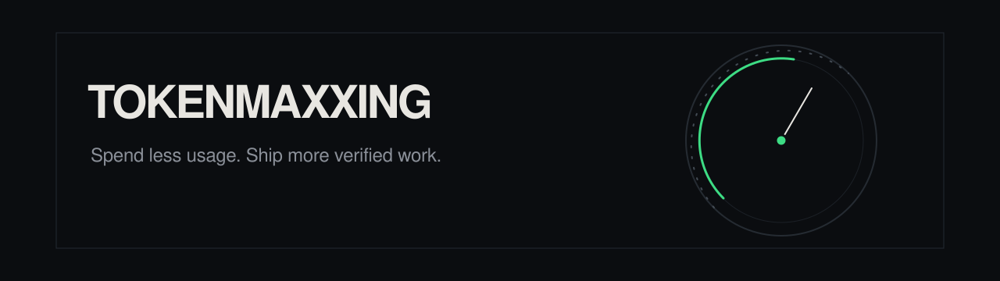
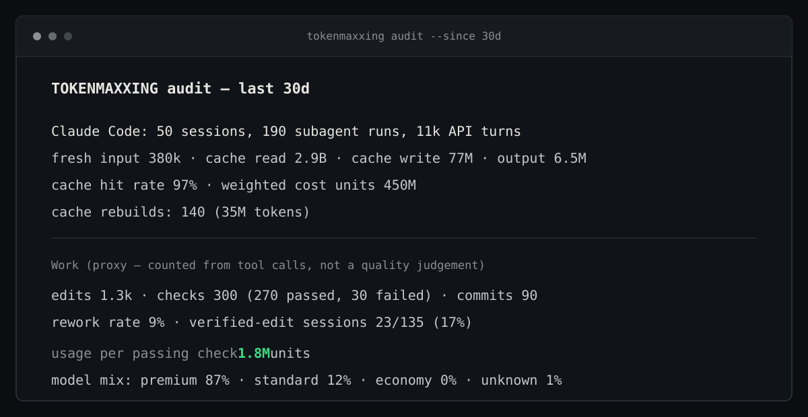
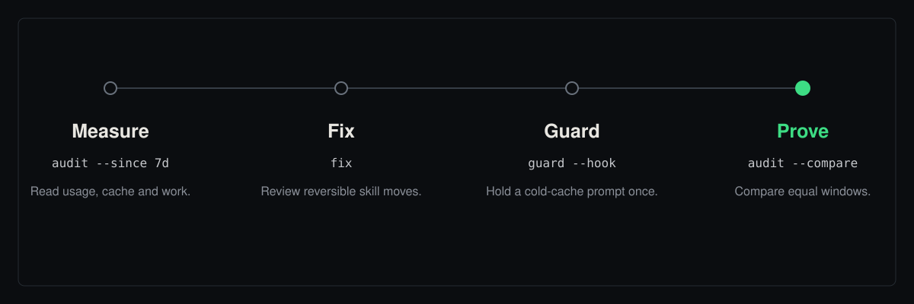

TOKENMAXXING measures local Claude Code and Codex usage against verified work,
then offers reversible setup cleanup and an opt-in cold-cache guard.

[](https://github.com/ohnoshivm/tokenmaxxing/actions/workflows/ci.yml)
[](https://github.com/ohnoshivm/tokenmaxxing/releases/latest)
[](docs/installation.md)
[](docs/installation.md)

## Why this exists

> **One machine · 30-day sample:** 140 cache rebuilds accounted for about 35M tokens.
> Rework was 9%; 17% of edit sessions had a passing check after the final edit.
> These local logs are a measurement sample, not a benchmark or a savings claim.

## Quickstart

Clone the repository and run the local measurements directly:

```bash
git clone https://github.com/ohnoshivm/tokenmaxxing.git
cd tokenmaxxing
python3 tokenmaxxing.py audit --since 7d
python3 tokenmaxxing.py doctor
```

The CLI requires Python 3.9+ and uses only the standard library. No install
step is needed for these measurements.

## Sample audit



Rounded output from one machine's local 30-day logs. The Work block is a
tool-call proxy, not a quality score; this sample is not a benchmark.

## Measure → Fix → Guard → Prove

Run these commands from the repository checkout with `python3 tokenmaxxing.py`.



## Commands

| Command | What it does | Writes? |
| --- | --- | --- |
| `audit` | Measure local usage and the work proxy. | No. |
| `doctor` | Inspect always-loaded setup overhead. | No. |
| `fix` | Plan reversible skill moves. | No by default; `--apply` moves files. |
| `guard` | Opt-in cold-cache prompt hold. | Marker files only when active. |
| `statusline` | Show context and cache status. | No; `--install` prints a snippet. |
| `reset` | Configure reset windows and inspect notifications. | Setup writes config; live checks write state. |
| `install` | Install the skill and stage eight pinned sources. | Yes; may fetch unless `--no-fetch` is used. |
| `status` | Inspect staged sources and the installed skill. | No. |
| `profiles` | List task profiles. | No. |
| `plugin-commands NAME` | Print candidate commands; never run them. | No. |

## Safety guarantees

The measurement path is offline and read-only by default. Commands that write
are explicit and their effects are listed above.

- `audit` and `doctor` read local data. Nothing is uploaded; audit reports
  exclude transcript text, and doctor never prints MCP secrets.
- `fix` defaults to a dry run. With `--apply`, it only moves skill files,
  writes a manifest before moving, and supports `--undo`; it never deletes.
- TOKENMAXXING never edits `settings.json`, authentication files or provider
  configuration.
- `statusline --install` and `guard --print-hook` print snippets for you to
  review and apply yourself.
- Pinned optimizer sources are not enabled automatically. The installer does
  not install their dependencies or execute their code.
- Reset notifications are inactive until configured. Provider dispatch
  requires an explicit opt-in and a verified account-specific command.

## Operating pillars

- **Delegation:** task-fit guidance, handoffs and verification live in the
  [routing policy](policy/routing-policy.yaml) and
  [delegation research](research/delegation-paper-2026.md). The policy is
  reference material; it does not configure automatic routing.
- **Usage efficiency:** measure cache, setup overhead and work, then compare
  equal windows using the [token-efficiency policy](policy/token-efficiency.md)
  and [measurement notes](docs/measurement.md).

## Documentation

### Start and measure

- [Installation and verification](docs/installation.md) — install options,
  offline measurement and scope.
- [Extended quickstart](docs/quick-start.md) — safe manual setup and
  verification workflow.
- [Mission and measurement notes](docs/measurement.md) — metric definitions,
  limits and research map.

### Commands and setup

- [Reversible cleanup](docs/fix.md) — dry run, archive manifest and undo.
- [Cold-cache guard](docs/guard.md) — hook behavior, setup and safety.
- [Status line](docs/statusline.md) — context and cache display, install snippet and limits.
- [Reset windows](docs/reset-activation.md) — inactive setup, notifications and
  explicit dispatch rules.
- [Optimizer profiles](docs/optimizer-profiles.md) — controlled comparison and
  candidate evidence.
- [T3 Chat guide](docs/t3-chat.md) — portable policy without assumed native
  automation.

### Policies and research

- [Delegation routing policy](policy/routing-policy.yaml)
- [Token-efficiency policy](policy/token-efficiency.md)
- [Delegation research](research/delegation-paper-2026.md)
- [Claude Code token-efficiency research](research/claude-code-token-maxxing-2026.md)
- [Optimizer behavior comparison](research/optimizer-behavior-comparison-2026.md)

### Project records

- [Changelog](CHANGELOG.md)
- [Third-party credits](CREDITS.md)
- [Citation metadata](CITATION.cff)

## Attribution

**Created by Shivam Kumawat (@ohnoshivm) · AgentKind Labs**
([profile](https://github.com/ohnoshivm)). See [credits](CREDITS.md) and
[citation](CITATION.cff). Licensed under the [MIT License](LICENSE).
